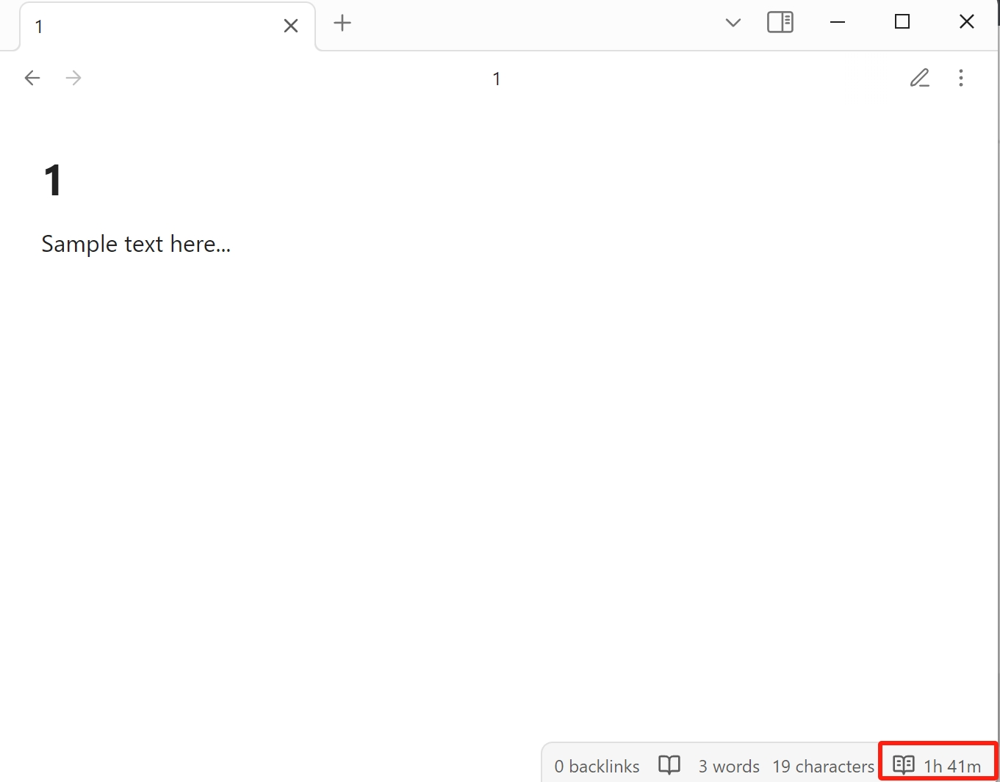
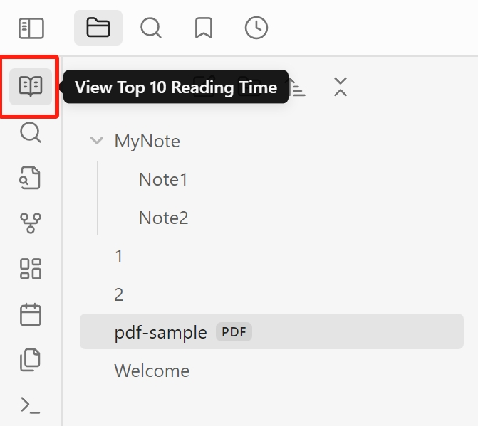
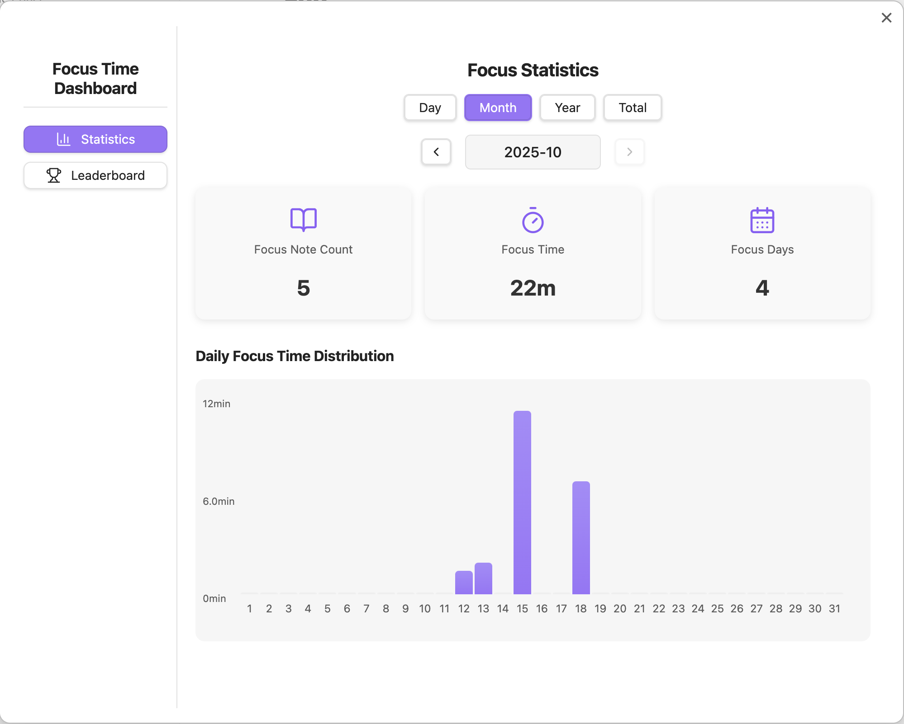

# Focus Time Plugin

English | [简体中文](README_zh.md)

The Focus Time Plugin automatically tracks the time you spend focused on your notes and provides comprehensive data analytics. With this tool, you can better review your focus journey, uncover "hidden gem notes" marked by time, and make your Obsidian note-taking more planned and rewarding!

If you find this plugin useful, you can support me on [Buy Me a Coffee](https://buymeacoffee.com/astradev123). Your encouragement is the driving force behind my continued development.

## Features Overview

- **Accurate tracking**: idle detection with separate reading thresholds, midnight splitting, sleep-safe timing, and exact settlement on note switches.
- **Local-first event log**: append-only monthly shards per device, stored in `_focus_time/` inside your vault. No database, no write conflicts.
- **Automatic migration**: existing `data.json` and day files are backed up, imported and verified; original files are never modified.
- **Analytics dashboard**: overview, trends, notes, folders and data quality, with calendar heatmaps, time-of-day grids, session histograms and rule-based insights.
- **Exports**: CSV sessions, full JSON backup, and a Markdown report.
- **Inline stats**: embed a `focus-time` code block in any note.
- **Languages**: English, 简体中文, 繁體中文, 日本語, 한국어; follows Obsidian's language by default.

## Key Features

### 📊 Data Analytics Dashboard
- **Multi-dimensional Views**: Support for day, month, year, and total time dimension analysis
- **Smart Date Navigation**: Quick time range switching with date, month, and year navigation
- **Key Metrics Display**: Focus note count, focus time, and focus days at a glance
- **Interactive Charts**: Click charts to drill down to more detailed time dimensions

### 📈 Visualization Charts
- **Monthly View**: Display daily focus time distribution
- **Yearly View**: Show monthly focus time trends
- **Total View**: Display focus time changes over the last 10 years
- **Dynamic Units**: Automatically select hours or minutes display based on data size

### 📱 Responsive Interface
- **Desktop**: Left-right sidebar layout with fixed sidebar display
- **Mobile**: Collapsible sidebar with gesture support

## Data storage

Focus Time keeps its data inside your vault, under `_focus_time/`:

- `events/YYYY-MM.<device>.jsonl` — append-only session events. Each device writes its own shard, so two devices never write the same file.
- `notes.json` — stable note ids and their current paths.
- `meta.json` — schema version and migration state.
- `archive/` — a read-only copy of the previous `data.json` and day files, created before migration.
- `reports/` — migration reports.
- `exports/` — CSV / JSON / Markdown exports.

The legacy `data.json` and `data/*.json` files are only read during migration and are never deleted.

## Commands

- Open the Focus Time dashboard
- Pause or resume focus tracking
- Rescan legacy focus data
- Export sessions as CSV, data as JSON, or a report as Markdown
- Write focus totals to the current note's frontmatter

## Installation Instructions

Follow these steps to install the plugin:

1. In Obsidian, navigate to **Settings** → **Community Plugins** → **Search for "Focus Time"** → **Install the plugin**.
2. Enable the plugin under the **Community Plugins** settings.

## User Guide

### Track Focus Time

Every time you open a note, the plugin automatically starts tracking your focus time, which is displayed in the status bar at the bottom right. When you switch notes or minimize Obsidian, the plugin stops tracking and saves the data (you can disable window detection in the plugin settings by turning off focus mode).

### View the Data Analytics Dashboard

To view your focus time data analytics:

1. Click the Dashboard button in the left sidebar.

   

2. The Dashboard will display your focus time analytics data, including:
   - **Reading Data**: Day/month/year/total view focus time statistics
   - **Leaderboard**: Top 10 notes ranked by focus time

   

### Using Data Analytics Features

- **Switch Views**: Select "Reading Data" or "Leaderboard" in the left sidebar
- **Time Navigation**: Use the date navigator at the top to switch between different time ranges
- **Chart Interaction**: Click on bar charts to drill down to more detailed time dimensions
- **Note Navigation**: Click on focus note list items to directly open corresponding notes

## Contributing

Feel free to fork this project, report issues, or submit pull requests to improve and fix the plugin.

## License

This plugin is open source and licensed under the [Apache 2.0 License](LICENSE).
