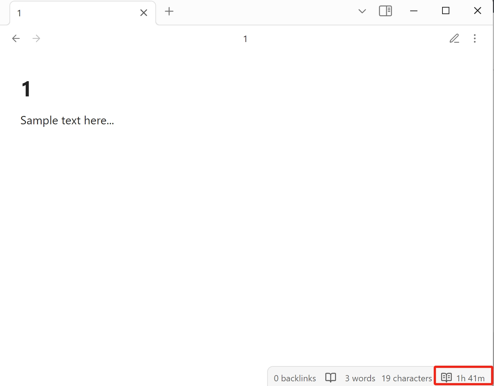
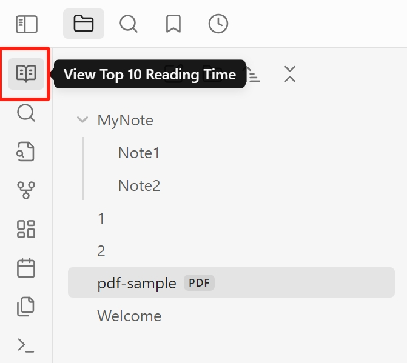

# 专注时间插件

[English](README.md) | 简体中文

专注时间插件能够自动记录你的笔记专注时长，并提供全面的数据分析功能。有了它，你能更好地回顾自己的专注历程，发现那些被时光见证的 "宝藏笔记"，让你的 Obsidian 笔记时光更有规划、更具成就感！

如果你觉得插件好用，可以在[爱发电](https://afdian.com/a/astradev)支持我，你的鼓励是我持续开发的动力。

## 功能概述

- **更准的计时**：空闲检测（阅读可单独设阈值）、跨午夜切分、睡眠安全、切笔记精确结算。
- **本地事件日志**：按月和设备分片的只追加 JSONL，存放在插件目录下的 `store/`，文件列表里不可见，不用数据库，也不会写冲突。
- **自动迁移**：旧版 `data.json` 和日文件会先备份、再导入、再校验，原文件不会被修改。
- **分析仪表盘**：概览、趋势、笔记、分类，包含编辑/阅读拆分、目标达成率、新笔记/回访、日历热力图、时段分布、会话长度直方图和规则洞察。
- **导出**：CSV 会话明细、JSON 全量备份、Markdown 报告。
- **内嵌统计**：在任意笔记里插入 `focus-time` 代码块。
- **多语言**：English、简体中文、繁體中文、日本語、한국어，默认跟随 Obsidian 语言。

## 主要功能

### 📊 数据分析 Dashboard
- **多维度视图**：支持日、月、年、总四个时间维度的数据分析
- **智能日期导航**：快速切换时间范围，支持日期、月份、年份导航
- **关键指标展示**：专注笔记数、专注时间、专注天数一目了然
- **交互式图表**：点击图表可钻取到更详细的时间维度

### 📈 可视化图表
- **月度视图**：显示每日专注时长分布
- **年度视图**：显示每月专注时长趋势
- **总体视图**：显示近10年专注时长变化
- **动态单位**：根据数据大小自动选择小时或分钟显示

### 📱 响应式界面
- **桌面端**：左右分栏布局，侧边栏固定显示
- **移动端**：可折叠侧边栏，支持手势操作

## 数据存储

数据保存在插件目录下的 `.obsidian/plugins/focus-time/store/`：

- `events/YYYY-MM.<device>.jsonl`：只追加的会话事件，每台设备一个分片，两台设备不会写同一个文件。
- `notes.json`：笔记 id 与当前路径的映射。
- `meta.json`：存储版本与迁移状态。
- `archive/`：迁移前的 `data.json` 与日文件只读备份。
- 旧版本写在 vault 根目录的 `_focus_time/` 会在启动时自动搬进 `store/`。
- 数据在插件目录里，删除插件文件夹会一起删除数据；卸载前请先导出备份。
- `reports/`：迁移报告。
- `exports/`：CSV / JSON / Markdown 导出。

旧版的 `data.json` 和 `data/*.json` 只在迁移时读取，不会被删除。

## 命令

- 打开专注时间仪表盘
- 暂停或继续专注计时
- 重新扫描旧版专注数据
- 导出会话 CSV、数据 JSON、报告 Markdown
- 将专注时长写入当前笔记的 frontmatter

## 安装说明

安装此插件的步骤：

1. 在 Obsidian 中，打开 **设置** → **第三方插件** → **搜索 Focus Time** → **安装插件**。
2. 在 **第三方插件** 设置中启用插件。

## 使用指南

### 记录专注时长

每当你打开一篇笔记时，插件会开始自动记录你的专注时长，并显示在右下角的状态栏上。当你切换笔记或者将 Obsidian 最小化时，插件会停止记录并保存数据（可在插件设置中关闭专注模式来禁用窗口检测）。

### 查看数据分析Dashboard

要查看你的专注时间数据分析：

1. 点击左侧边栏的Dashboard按钮

   

2. Dashboard将展示你的专注时间分析数据，包括：
   - **阅读数据**：日/月/年/总视图的专注时间统计
   - **排行榜**：专注时间排名前十的笔记

   

### 使用数据分析功能

- **切换视图**：在左侧边栏选择"阅读数据"或"排行榜"
- **时间导航**：使用顶部的日期导航器切换不同时间范围
- **图表交互**：点击柱状图可钻取到更详细的时间维度
- **笔记跳转**：点击专注笔记列表中的条目可直接打开对应笔记

## 贡献

欢迎 Fork 本项目，并提交问题报告或拉取请求进行改进和修复。

## 许可协议

本插件完全开源，遵循 [Apache 2.0 许可证](LICENSE)。

