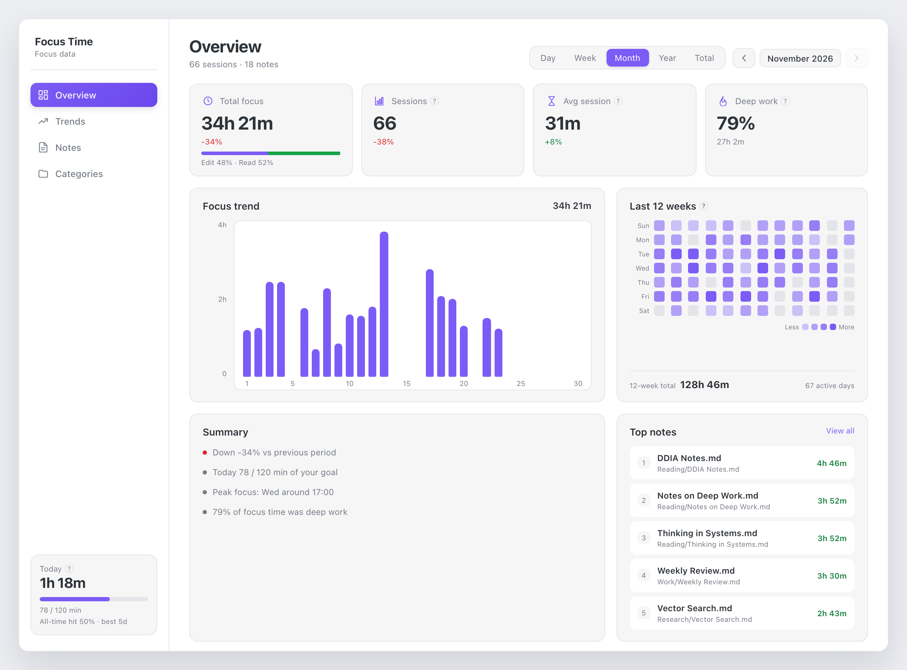
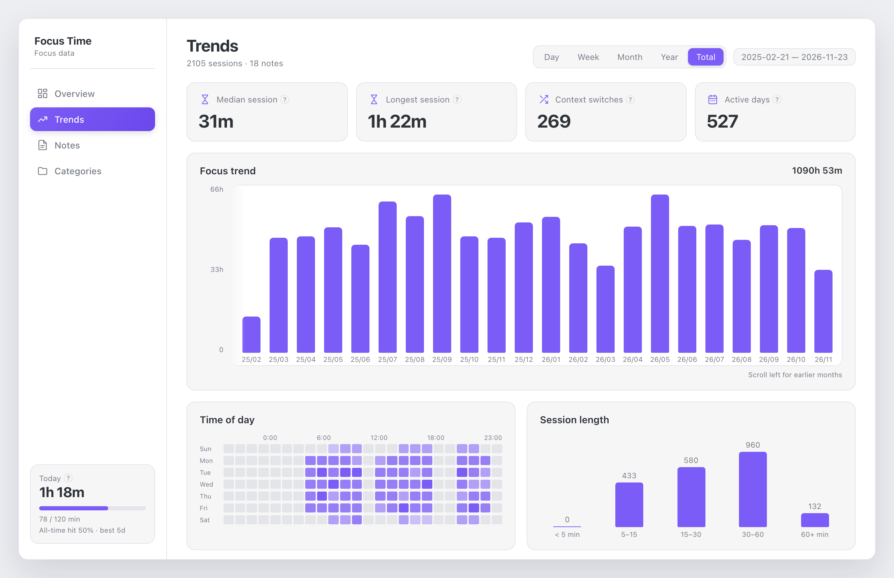
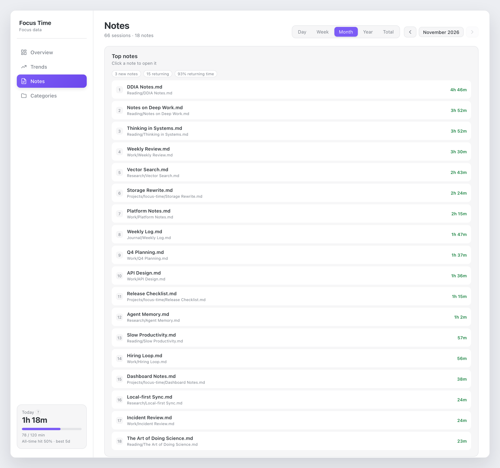
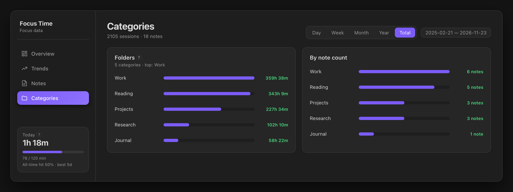
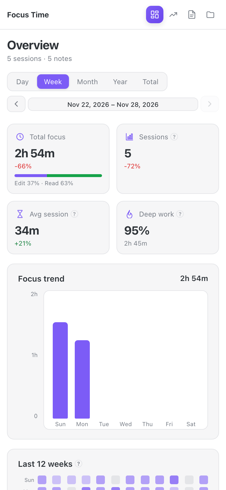

# 专注时间

[English](README.md) | 简体中文

专注时间记录你在每篇笔记上花了多少时间，并把它整理成仪表盘：时间去了哪里、哪些笔记反复回看、你通常在什么时候工作。



## 记录了什么

一篇 Markdown 笔记在活动标签页打开时，会话开始；切换笔记、离开窗口、进入空闲或跨过零点时结束。23:40 到 00:20 会拆成两段，一天一段。

每段会话还会记录是编辑还是只读，所以仪表盘能给出编辑与阅读的占比，而不是一个笼统的总数。

空闲判定以输入为准：打字、点击、滚动、选中文字都会重置计时，只移动鼠标不算。阈值可以调整，阅读可以单独设一个更长的阈值。

状态栏显示当前笔记的时长，暂停时会说明原因。

## 仪表盘

五个时间范围（日、周、月、年、总），四个标签页：

| 标签页 | 内容 |
| --- | --- |
| 概览 | 总时长、编辑/阅读拆分、专注趋势、近 12 周日历、要点小结、笔记排行 |
| 趋势 | 中位数与最长会话、切换次数、活跃天数、星期×时段热力图、会话长度分布 |
| 笔记 | 按专注时长排序，附新笔记与回访数量 |
| 分类 | 按顶层目录统计时长和笔记数，点击可筛选笔记页 |







指标旁的小问号会说明这个数字是怎么算的，可以在设置里关掉。

手机上会收成单列：



## 安装

1. 打开 **设置 → 第三方插件 → 浏览**，搜索 "Focus Time"。
2. 安装后在 **第三方插件** 中启用。

## 命令

- **打开专注时间仪表盘**，也可以点左侧边栏的图标。
- **暂停或继续专注计时**
- **重新扫描旧版专注数据**：重新导入 1.x 的文件，已经导入过的记录会跳过。
- **导出会话 CSV**、**导出数据 JSON**、**导出报告 Markdown**：输出到 `store/exports/`。
- **将专注时长写入当前笔记**：在 frontmatter 里写 `focus_total`（分钟）和 `focus_updated`（日期）。

## 内嵌统计

在笔记中插入 `focus-time` 代码块，会显示所选范围的时长和会话数：

````markdown
```focus-time
month
```
````

可选值：`today`、`week`（默认）、`month`、`note`（当前笔记）、`total`。

## 设置

| 设置 | 默认 | 说明 |
| --- | --- | --- |
| 语言 | 跟随 Obsidian | English、简体中文、繁體中文、日本語、한국어 |
| 严格模式 | 开 | 窗口失去焦点时停止计时 |
| 空闲检测 | 5 分钟 | 可关闭、自定义，或为阅读单独设阈值 |
| 每日专注目标 | 60 分钟 | 用于侧栏的目标进度和连续达标 |
| 概念提示 | 开 | 上面提到的小问号 |

## 数据位置

数据都在插件目录里：`.obsidian/plugins/focus-time/store/`。

```
store/
  events/2026-11.<device>.jsonl    会话事件，每台设备每月一个分片
  notes.json                       笔记 id 与当前路径
  meta.json                        存储版本与迁移状态
  archive/v0-<timestamp>/          导入前的 1.x 数据副本
  reports/migration-<timestamp>.json
  exports/
```

分片只追加，每个事件带 id，同一份数据导入两次不会重复计算。每台设备写自己的文件，加载时统一合并。笔记 id 是稳定的，重命名笔记或整目录移动都不会丢历史。

数据在插件目录内，删除插件文件夹会一起删除数据；之后可能重装的话，先导出。

设置项保存在插件目录的 `data.json` 里，和 `store/` 相邻。

## 从 1.x 升级

首次启动时如果检测到 1.x 数据，插件会把 `data.json` 和 `data/*.json` 复制到 `store/archive/`，导入、核对总量，然后把报告写到 `store/reports/`。原文件只读不写。

如果数字不对，运行 **重新扫描旧版专注数据**，已导入的事件会跳过。1.x 读不了新的事件日志，打算回退的话请保留 archive。

## 开发

```bash
npm install
npm run dev      # 监听构建
npm run check    # 多语言、测试、类型检查、打包
npm run shots    # 重新生成 asset/ 里的截图
```

`npm run shots` 用固定的示例数据和 headless Chrome 渲染仪表盘。Chrome 不在默认位置时，用 `CHROME_PATH` 指定。

## 支持

如果它帮到了你，可以[请我喝杯咖啡](https://afdian.com/a/astradev)。

## 许可协议

[Apache 2.0](LICENSE)
