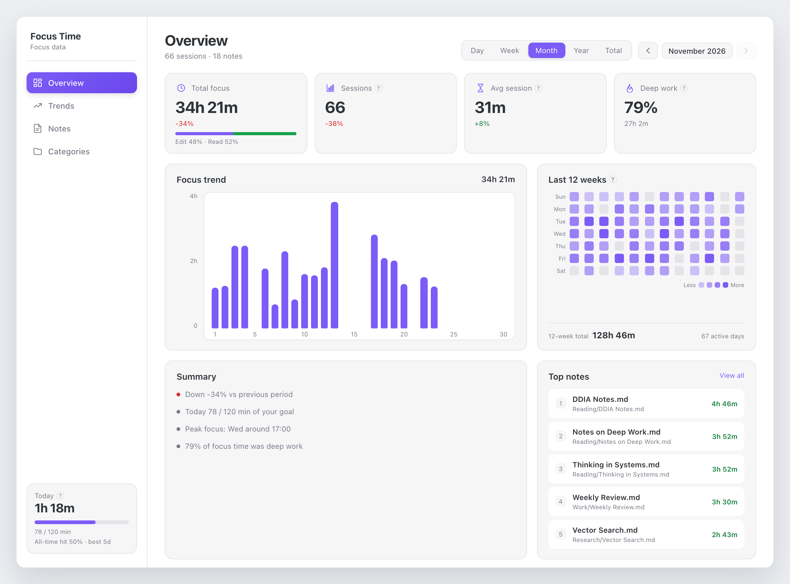

## Focus Time 2.0

This release replaces the single `data.json` file with an event log and rebuilds the dashboard on top of it. Existing 1.x history is imported on first start; see **Upgrading** below.

### Dashboard

- Four tabs — Overview, Trends, Notes, Categories — and five ranges: day, week, month, year, total. Total starts at your first session.
- Overview shows total time with an edit/read split, deep work (sessions of 25 minutes or more), a 12-week calendar, a short written summary, and top notes.
- Trends adds median and longest session, note switches within 30 minutes, active days, an hour-by-weekday heatmap and a session length histogram.
- Notes lists notes ranked by time, with new and returning counts for the range.
- Categories groups time and note count by top-level folder. Clicking a folder filters the notes list.
- The sidebar tracks today's time against a daily goal, plus the all-time goal hit rate and longest streak.
- The dashboard now opens as a workspace tab instead of a modal, so it can sit next to your notes.
- Metric labels carry optional "?" hints, which can be turned off in settings.

### Tracking

- Idle detection can be off, a fixed threshold, a custom threshold, or a separate and longer threshold for reading. Typing, clicking, scrolling and selecting text count as input; moving the mouse does not.
- Sessions are split at midnight and settled when you switch notes, leave the window or go idle.
- Strict mode stops counting while the window is not focused.

### Storage and exports

- Sessions are appended to `store/events/YYYY-MM.<device>.jsonl`, one shard per device per month. Every event has an id, so importing the same data twice does not double count.
- Note ids are stable and renames are recorded as events, so moving a note or a whole folder keeps its history.
- 1.x `data.json` and `data/*.json` files are copied to `store/archive/` before import and only read.
- New commands: export sessions as CSV, export all data as JSON, export a Markdown report. Files are written to `store/exports/`.
- New: a `focus-time` code block for any note (`today`, `week`, `month`, `note`, `total`).
- New: a command that writes `focus_total` and `focus_updated` to the current note's frontmatter.

### Languages

English, 简体中文, 繁體中文, 日本語 and 한국어. The plugin follows Obsidian's language by default and can be pinned in settings.

### Upgrading from 1.x

- On first start with 1.x data present, the plugin imports it, checks the totals, and writes a report to `store/reports/`.
- Session data now lives in `.obsidian/plugins/focus-time/store/` rather than `data.json`; settings stay in `data.json`.
- The old Leaderboard tab is gone; the Notes tab covers it and adds ranges, new/returning counts and folder filtering.
- If the imported numbers look wrong, run **Rescan legacy focus data** from the command palette. Events that were already imported are skipped.
- 1.x cannot read the event log. Keep `store/archive/` if you might downgrade.

### Requirements

Obsidian 1.5.7 or newer, desktop or mobile.

**Full changelog:** [1.3.0...2.0.0](https://github.com/astradev123/obsidian-focus-time/compare/1.3.0...2.0.0)
